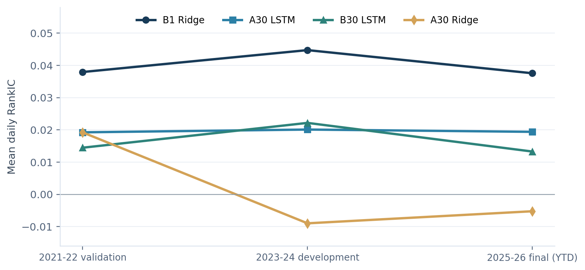
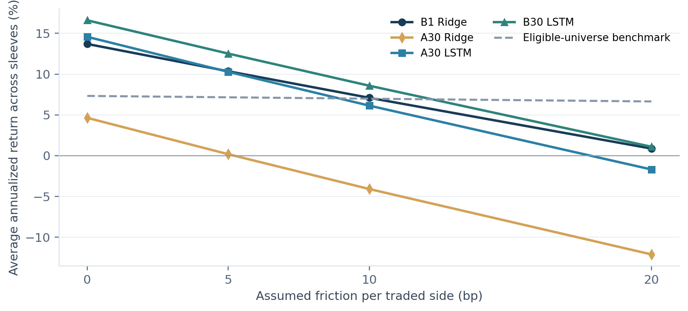

# A股金融特征表达与历史序列建模研究

**A-Share Factor Representation, Temporal Information and Return Prediction**

研究基础量价特征与滚动金融因子的历史信息增量，比较 Ridge、MLP、LightGBM 和 LSTM 在 A 股日频截面收益预测任务中的表现，并评估跨时期泛化和理论组合收益。

**[阅读完整研究报告（PDF，6页）](docs/Research_Report.pdf)** · [实验设计](docs/EXPERIMENT_DESIGN.md) · [实验结果](docs/RESULTS_INDEX.md) · [复现说明](docs/REPRODUCIBILITY.md) · [数据与交易局限](docs/DATA_LIMITATIONS.md)

## 研究设定

- **股票池：** 本地 Qlib 历史沪深300成分区间；历史成分公告时点来源未独立认证。
- **信号时刻：** 每个交易日收盘后；目标为未来5个开盘到开盘交易区间的收益率，`Open(t+6) / Open(t+1) - 1`。
- **输入：** 8项基础量价特征，与16项滚动金融因子；比较单日和多日历史窗口。
- **模型：** Ridge、MLP、LightGBM、LSTM；相同信息集对照、顺序扰动和3个随机种子的稳定性检查。
- **时间划分：** 2016—2020年训练；2021—2022年探索验证；2023—2024年跨时期评价；2025—2026年最终评价（2026年仅至10月23日的有效信号）。
- **主要指标：** 每日截面 Spearman RankIC 的日期等权平均，辅以 Pearson IC、MSE、配对 Newey–West/HAC 区间与理论收益分组。

## 主要实证结果

| 实验或模型 | 核心结果 | 评价样本 |
|---|---:|---|
| 基础量价 LSTM：30日 vs 1日历史 | RankIC **+0.02712** | 2021—2022 探索验证 |
| 滚动因子 LSTM：30日 vs 1日历史 | RankIC **−0.00501** | 2021—2022 探索验证 |
| 基础量价 LSTM：训练和评价均扰动历史顺序 | RankIC **−0.02066** | 2021—2022 探索验证 |
| 单期滚动因子 Ridge | RankIC **0.03756** | 2025—2026 最终评价 |
| 30日基础量价 LSTM | RankIC **0.01939** | 2025—2026 最终评价 |
| 30日基础量价 Ridge | RankIC **−0.00524** | 2025—2026 最终评价 |
| 30日滚动因子 LSTM：Q5−Q1 | 理论5日收益差 **+0.355个百分点** | 2025—2026 最终评价 |

验证期的特征表达与顺序扰动结果支持两种输入表示对历史信息的增量利用存在差异。最终评价中，单期滚动因子 Ridge 保持较高 RankIC；30日基础量价 LSTM 的跨时期 RankIC 相对稳定，且在后两个阶段优于同信息集的 Ridge。统计预测与理论组合收益分别评价，模型架构及数据条件的限制详见报告。

### 跨时期评价



### 交易成本敏感性



## 仓库结构

```text
00_audit.py ... 12_final_evaluation.py     # 数据构建、实验与冻结评价的13个入口
lstm_research/                           # 特征、序列、模型、指标及数据审计模块
tests/                                   # 93项单元/流程接口测试
results/verified_summaries/              # 已核对的实际实验结果（CSV/JSON）
docs/Research_Report.pdf                 # GitHub正式展示版报告
docs/assets/                             # 研究图表
docs/EXPERIMENT_DESIGN.md                # 研究协议与实验比较
docs/RESULTS_INDEX.md                    # 主要结果及证据文件定位
docs/REPRODUCIBILITY.md                  # 环境、运行顺序与可复现性说明
docs/DATA_LIMITATIONS.md                 # 数据来源与真实交易解释边界
archive_metadata/model_registry_sha256.json  # 冻结模型检查点哈希
scripts/                                 # 本地模型核验与私有备份工具
requirements.txt                         # 直接依赖（不含精确环境lock）
```

## 运行与复现

源码已在 **Python 3.11 / Qlib 0.9.7 / PyTorch（Apple Silicon MPS）** 环境上运行。代码包包含程序、轻量结果与哈希清单，**不包含模型权重、Qlib历史行情数据库和大型特征缓存**。因此可以检查公开代码与实验结果，完整重训需要相同的数据快照及对应运行环境。

```bash
python3.11 -m venv .venv
source .venv/bin/activate
python -m pip install -r requirements.txt
python -m unittest discover -s tests -q
```

如需在原研究机器核对已冻结的模型文件，运行：

```bash
python scripts/verify_local_sources.py
```

上述核对需要原始 `output/` 检查点，纯公开源码包上会明确报告文件缺失。完整步骤及数据准备见 [REPRODUCIBILITY.md](docs/REPRODUCIBILITY.md)。

## 研究解释边界

- 验证期中多轮探索后的统计显著性属于**探索性证据**，不能理解为独立多重比较校正的确认性检验。
- 2023—2024年开发评价及2025—2026年最终评价均直接复用冻结权重，未针对最终评价重新拟合。
- 历史股票池在本地记录中核对一致，但历史成分变更公告时点未做外部独立认证；存在少量未来标签可观测性条件筛选。
- 经济结果使用复权开盘价和情景成本，属于**理论经济价值诊断**，未认证涨跌停真实成交、集合竞价、滑点和市场冲击。

完整指标定义、配对区间及方法讨论见 [研究报告 PDF](docs/Research_Report.pdf)。

---

*English summary: This empirical study evaluates the incremental value of historical information under two A-share feature representations (daily price-volume features and rolling factors). Controlled window, order-perturbation and model comparisons are followed by frozen cross-period assessments and hypothetical transaction-cost diagnostics. Code, verified summary tables and protocol documentation are public; proprietary market snapshots and model checkpoints are not included.*
